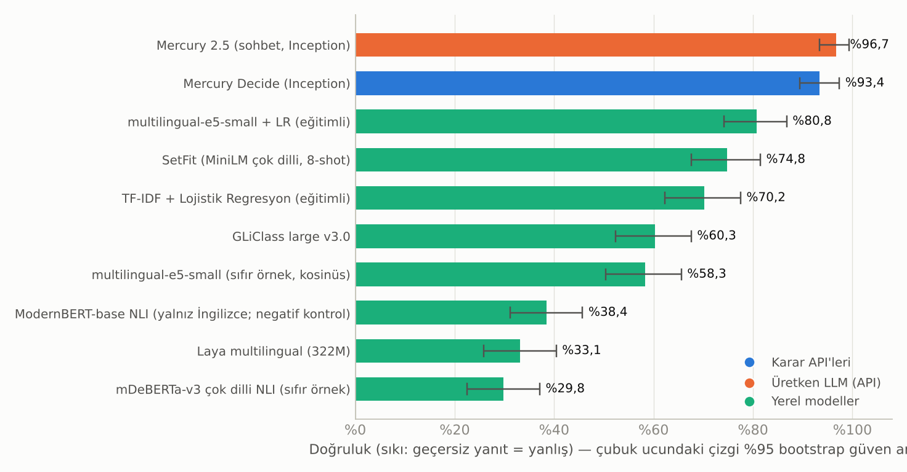
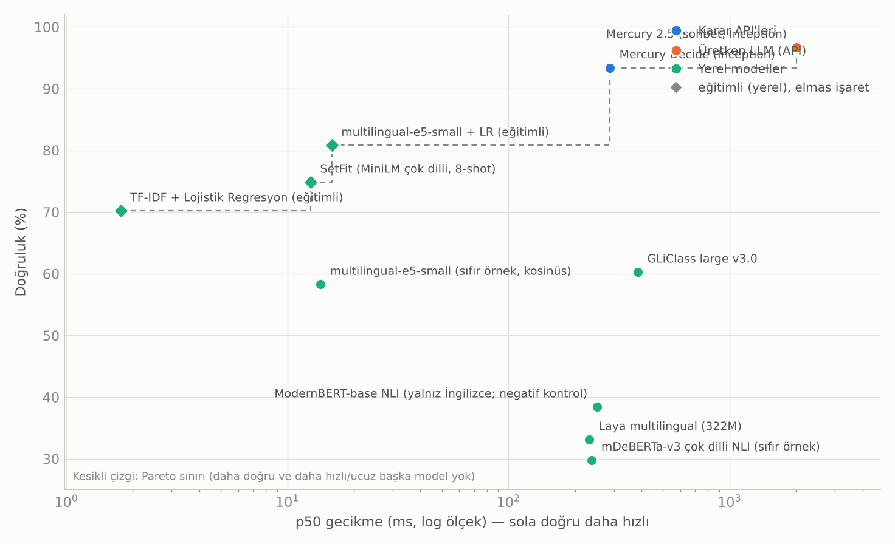
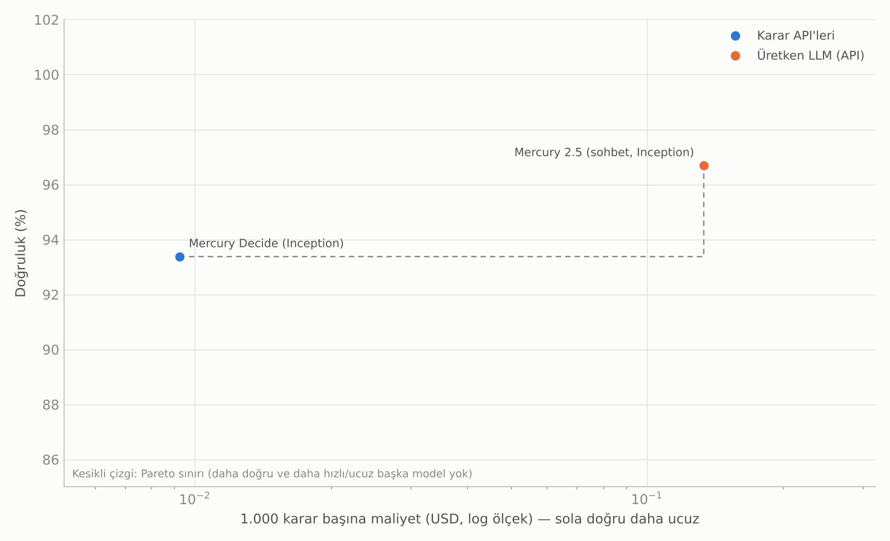
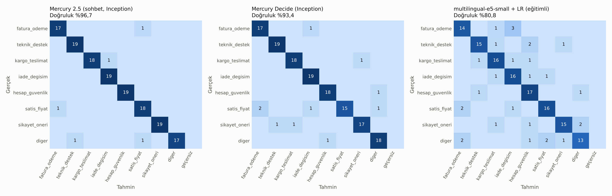
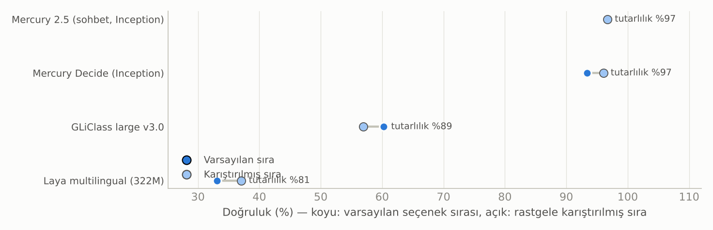

# Classifier LLM karşılaştırma raporu

Koşu: `20261012-155610-inception-yerel` · oluşturma: 2026-10-12T15:56:10

## Koşul özeti

**Veri:** `destek_tr` · değerlendirme bölümü: `test` (151 örnek) · eğitim bölümü: 128 örnek · parmak izi `9ac13de53ff85f2d`

**Sınıf dağılımı (değerlendirme):** fatura_odeme: 18, teknik_destek: 19, kargo_teslimat: 19, iade_degisim: 19, hesap_guvenlik: 19, satis_fiyat: 19, sikayet_oneri: 19, diger: 19

**Ayarlar:** tohum 0 · etiket başına few-shot 0 · istem sürümü `v1` · seçenek sırası testi: evet

**Ortam:** Python 3.13.16 · Linux-6.18.44-fc-v114-x86_64-with-glibc2.39

**Not:** Gerçek koşu: Inception API modelleri (Mercury Decide, Mercury 2.5) ve tüm yerel modeller. Diğer servislerin anahtarı tanımlı olmadığı için atlandı. Gecikmeler bulut kapsayıcısında (CPU, tek istemci konumu) ölçüldü.

## Öne çıkan bulgular

**En yüksek doğruluk:** Mercury 2.5 (sohbet, Inception) — %96,7 (%95 GA %93,4–%99,3), macro-F1 %96,7.

**İstatistiksel olarak ayırt edilemeyenler (Mercury 2.5 (sohbet, Inception) ile eşlenmiş bootstrap farkının %95 aralığı 0'ı içeriyor):** Mercury Decide (Inception). Bu modeller arasında bu örneklemle kesin sıralama yapılamaz.

**En düşük p50 gecikme:** TF-IDF + Lojistik Regresyon (eğitimli) — 1,8 ms (doğruluk %70,2).

**En düşük ölçülen API maliyeti:** Mercury Decide (Inception) — $0,0092 / 1.000 karar (doğruluk %93,4).

**Doğruluk–gecikme Pareto sınırı:** Mercury 2.5 (sohbet, Inception), Mercury Decide (Inception), multilingual-e5-small + LR (eğitimli), SetFit (MiniLM çok dilli, 8-shot), TF-IDF + Lojistik Regresyon (eğitimli).

**Doğruluk–maliyet Pareto sınırı (yalnız fiyatı bilinen API modelleri):** Mercury 2.5 (sohbet, Inception), Mercury Decide (Inception).

## Ana sonuç tablosu

Doğruluk sıkıdır: geçersiz veya başarısız yanıtlar yanlış sayılır, oranı ayrıca verilir. Köşeli parantez: %95 bootstrap güven aralığı. ECE: kalibrasyon hatası (yüzde puan; düşük iyi). Gecikme: istemci tarafı uçtan uca ms. Maliyet: ölçülen token × tarife, 1.000 karar için USD; `~` token sayısının API'den gelmeyip tahmin edildiğini, `yerel` API ücreti olmadığını gösterir (altyapı maliyeti hariç).

| # | Model | Grup | Doğruluk [%95 GA] | Macro-F1 | Geçersiz | ECE | p50 ms | p95 ms | $/1.000 karar |
|---:|:---|:---|---:|---:|---:|---:|---:|---:|---:|
| 1 | Mercury 2.5 (sohbet, Inception) | Üretken LLM | %96,7 [%93–%99] | %96,7 | %0,0 | 2,0 pp | 2.008 | 3.812 | 0,1334 |
| 2 | Mercury Decide (Inception) | Karar API | %93,4 [%89–%97] | %93,3 | %0,0 | 5,0 pp | 288 | 384 | 0,0092 |
| 3 | multilingual-e5-small + LR (eğitimli) | Eğitimli | %80,8 [%74–%87] | %80,7 | %0,0 | 34,0 pp | 15,9 | 25,1 | yerel |
| 4 | SetFit (MiniLM çok dilli, 8-shot) | Eğitimli | %74,8 [%68–%81] | %75,1 | %0,0 | 11,7 pp | 12,8 | 17,3 | yerel |
| 5 | TF-IDF + Lojistik Regresyon (eğitimli) | Eğitimli | %70,2 [%62–%77] | %69,7 | %0,0 | 25,8 pp | 1,8 | 5,9 | yerel |
| 6 | GLiClass large v3.0 | Encoder | %60,3 [%52–%68] | %59,4 | %0,0 | 39,7 pp | 385 | 496 | yerel |
| 7 | multilingual-e5-small (sıfır örnek, kosinüs) | Encoder | %58,3 [%50–%66] | %55,6 | %0,0 | 37,3 pp | 14,1 | 19,5 | yerel |
| 8 | ModernBERT-base NLI (yalnız İngilizce; negatif kontrol) | Encoder | %38,4 [%31–%46] | %36,7 | %0,0 | 11,3 pp | 251 | 346 | yerel |
| 9 | Laya multilingual (322M) | Encoder | %33,1 [%26–%40] | %28,2 | %0,0 | 56,9 pp | 232 | 285 | yerel |
| 10 | mDeBERTa-v3 çok dilli NLI (sıfır örnek) | Encoder | %29,8 [%23–%37] | %31,6 | %0,0 | 18,1 pp | 239 | 329 | yerel |

## Kalibrasyon, hız ve kullanım ayrıntıları

Brier: çok sınıflı olasılık hatası (düşük iyi). **Güven türü** karşılaştırmayı sınırlar: üretken LLM'lerde 'sözel güven' modelin yazdığı sayıdır, yerel olasılık değildir; kalibrasyon sayıları bu yüzden doğrudan kıyaslanmamalıdır. Seçici doğruluk: modelin en emin olduğu %80 örnekteki doğruluk ve doğruluğu ≥%95 tutan en büyük kapsama. İlk istek (soğuk) gecikmesi ve kurulum/yükleme/eğitim süresi ayrı verilir; p50/p95 ısınmadan sonraki isteklerdir.

| Model | Brier | Güven türü | Doğruluk@%80 kapsama | Kapsama@%95 doğruluk | p99 ms | Soğuk ms | Kurulum | Eşzamanlılık | Ort. token (g/ç) |
|:---|---:|:---|---:|---:|---:|---:|---:|---:|---:|
| Mercury 2.5 (sohbet, Inception) | 0,065 | sözel güven | %96,7 | %100 | 5.636 | 1.858 | 0,0 sn | 4 | 521 / 750 |
| Mercury Decide (Inception) | 0,101 | yerel olasılık | %99,2 | %98 | 829 | 977 | 0,0 sn | 4 | 462 / 1 |
| multilingual-e5-small + LR (eğitimli) | 0,429 | yerel olasılık | %86,0 | %28 | 47,5 | 136 | 4,9 sn | 1 | — |
| SetFit (MiniLM çok dilli, 8-shot) | 0,391 | yerel olasılık | %81,8 | %40 | 22,9 | 146 | 160,4 sn | 1 | — |
| TF-IDF + Lojistik Regresyon (eğitimli) | 0,504 | yerel olasılık | %76,9 | %25 | 6,0 | 6,6 | 2,2 sn | 1 | — |
| GLiClass large v3.0 | 0,795 | türetilmiş, yerel olasılık | %60,3 | %1 | 530 | 422 | 16,5 sn | 1 | — |
| multilingual-e5-small (sıfır örnek, kosinüs) | 0,760 | türetilmiş | %66,1 | %14 | 21,2 | 27,3 | 12,8 sn | 1 | — |
| ModernBERT-base NLI (yalnız İngilizce; negatif kontrol) | 0,737 | yerel olasılık | %45,5 | %1 | 379 | 217 | 8,7 sn | 1 | — |
| Laya multilingual (322M) | 1,201 | yerel olasılık | %33,1 | %0 | 337 | 33.127 | 0,0 sn | 1 | — |
| mDeBERTa-v3 çok dilli NLI (sıfır örnek) | 0,850 | yerel olasılık | %31,4 | %3 | 380 | 270 | 13,8 sn | 1 | — |

## Doğruluk ve gecikme

Gecikme ölçümleri farklı donanım, bağlantı ve eşzamanlılık koşullarında alınmıştır (API: bu makineden uçtan uca; yerel: bu makinenin CPU/GPU'su). Kontrollü bir donanım yarışı değildir.

## Doğruluk ve maliyet

Yalnızca fiyatı bilinen API modelleri gösterilir; yerel modellerin altyapı maliyeti bu grafikte yoktur.

## Eşlenmiş karşılaştırma (referans: Mercury 2.5 (sohbet, Inception))

Aynı örnekler üzerinde doğruluk farkı (model − referans) ve %95 eşlenmiş bootstrap aralığı. Aralık 0'ı içeriyorsa bu örneklemle fark kanıtlanamaz.

| Model | Fark (puan) | %95 aralık | Sonuç |
|:---|---:|---:|:---|
| Mercury Decide (Inception) | -3,3 puan | -7,9 puan … +1,3 puan | ayırt edilemez |
| multilingual-e5-small + LR (eğitimli) | -15,9 puan | -22,5 puan … -9,9 puan | daha kötü |
| SetFit (MiniLM çok dilli, 8-shot) | -21,9 puan | -29,8 puan … -14,6 puan | daha kötü |
| TF-IDF + Lojistik Regresyon (eğitimli) | -26,5 puan | -34,4 puan … -18,5 puan | daha kötü |
| GLiClass large v3.0 | -36,4 puan | -45,0 puan … -28,5 puan | daha kötü |
| multilingual-e5-small (sıfır örnek, kosinüs) | -38,4 puan | -46,4 puan … -30,5 puan | daha kötü |
| ModernBERT-base NLI (yalnız İngilizce; negatif kontrol) | -58,3 puan | -66,2 puan … -50,3 puan | daha kötü |
| Laya multilingual (322M) | -63,6 puan | -71,5 puan … -55,6 puan | daha kötü |
| mDeBERTa-v3 çok dilli NLI (sıfır örnek) | -66,9 puan | -74,8 puan … -58,9 puan | daha kötü |

## Sınıf bazında F1

Satır başına model, sütun başına sınıf. Destek sayısı küçük olduğundan tek sınıftaki farklar gürültülü olabilir.

| Model | fatura_odeme | teknik_destek | kargo_teslimat | iade_degisim | hesap_guvenlik | satis_fiyat | sikayet_oneri | diger |
|:---|---:|---:|---:|---:|---:|---:|---:|---:|
| Mercury 2.5 (sohbet, Inception) | %94 | %97 | %97 | %97 | %100 | %92 | %100 | %94 |
| Mercury Decide (Inception) | %92 | %97 | %95 | %95 | %95 | %88 | %92 | %92 |
| multilingual-e5-small + LR (eğitimli) | %78 | %83 | %82 | %80 | %81 | %84 | %83 | %74 |
| SetFit (MiniLM çok dilli, 8-shot) | %79 | %84 | %76 | %74 | %87 | %67 | %76 | %57 |
| TF-IDF + Lojistik Regresyon (eğitimli) | %65 | %73 | %68 | %76 | %75 | %72 | %69 | %60 |
| GLiClass large v3.0 | %62 | %56 | %75 | %80 | %51 | %61 | %30 | %61 |
| multilingual-e5-small (sıfır örnek, kosinüs) | %65 | %69 | %73 | %65 | %52 | %57 | %38 | %26 |
| ModernBERT-base NLI (yalnız İngilizce; negatif kontrol) | %47 | %19 | %59 | %43 | %38 | %36 | %43 | %9 |
| Laya multilingual (322M) | %42 | %31 | %55 | %56 | %10 | %32 | %0 | %0 |
| mDeBERTa-v3 çok dilli NLI (sıfır örnek) | %36 | %10 | %69 | %22 | %54 | %30 | %20 | %11 |

## Karışıklık matrisleri (en doğru 3 model)

Satırlar gerçek, sütunlar tahmin edilen sınıf; renk satır normalizasyonudur, hücrelerdeki sayılar örnek sayısıdır.

## Zor örnek dilimleri

Doğruluk, örnek etiketine göre. En az 5 örnek içeren dilimler gösterilir; n küçük olduğundan yalnızca yön göstericidir.

| Model | Türkçe karaktersiz (ascii) | Çok niyetli | Çok kısa (≤4 sözcük) |
|:---|---:|---:|---:|
| Mercury 2.5 (sohbet, Inception) | %80 (n=5) | %80 (n=5) | %100 (n=12) |
| Mercury Decide (Inception) | %100 (n=5) | %80 (n=5) | %100 (n=12) |
| multilingual-e5-small + LR (eğitimli) | %80 (n=5) | %40 (n=5) | %75 (n=12) |
| SetFit (MiniLM çok dilli, 8-shot) | %60 (n=5) | %60 (n=5) | %67 (n=12) |
| TF-IDF + Lojistik Regresyon (eğitimli) | %80 (n=5) | %40 (n=5) | %50 (n=12) |
| GLiClass large v3.0 | %80 (n=5) | %40 (n=5) | %58 (n=12) |
| multilingual-e5-small (sıfır örnek, kosinüs) | %80 (n=5) | %60 (n=5) | %50 (n=12) |
| ModernBERT-base NLI (yalnız İngilizce; negatif kontrol) | %60 (n=5) | %0 (n=5) | %25 (n=12) |
| Laya multilingual (322M) | %0 (n=5) | %40 (n=5) | %25 (n=12) |
| mDeBERTa-v3 çok dilli NLI (sıfır örnek) | %80 (n=5) | %40 (n=5) | %25 (n=12) |

## Seçenek sırası dayanıklılığı

Etiket listesi her örnek için rastgele sıralanıp model yeniden çalıştırıldı. Tutarlılık: iki sırada aynı etiketi seçme oranı. Sıradan etkilenmeyen modeller (TF-IDF, gömme, NLI) bu testten muaftır.

| Model | Doğruluk (varsayılan) | Doğruluk (karıştırılmış) | Fark | Tutarlılık |
|:---|---:|---:|---:|---:|
| Mercury 2.5 (sohbet, Inception) | %96,7 | %96,7 | +0,0 puan | %97,4 |
| Mercury Decide (Inception) | %93,4 | %96,0 | +2,6 puan | %97,4 |
| GLiClass large v3.0 | %60,3 | %57,0 | -3,3 puan | %88,7 |
| Laya multilingual (322M) | %33,1 | %37,1 | +4,0 puan | %81,5 |

## Yöntem ve sınırlar

- **Veri:** Yerleşik `destek_tr` seti, bu çalışma için hazırlanmış *gümüş* etiketli bir örnek kümesidir; insan etiketli altın küme DEĞİLDİR. Bir satın alma kararı için kendi, insan etiketli Türkçe verinizle (`--dataset`) yeniden çalıştırın.

- **Bölme:** Değerlendirme yalnızca `test` (veya istenen) bölümünde yapılır; eğitimli modeller yalnızca `train` bölümünü görür; few-shot örnekleri de `train`'den alınır ve değerlendirmeden çıkarılır.

- **Aynı görev, doğal arayüz:** Karar API'leri kendi `choice` şemasıyla, üretken LLM'ler aynı Türkçe talimat + JSON şemasıyla, encoder modeller etiketlerin kısa Türkçe adlarıyla çağrılır. Bu, her modelin doğal arayüzünü adil kullanır ama modeller arasındaki farkın bir kısmı istem/arayüz farkından gelebilir.

- **Güven/olasılık:** Karar API'leri ve yerel modeller yerel olasılık verir; üretken LLM'ler sözel güven yazar. Brier/ECE bu yüzden aynı ölçekte değildir.

- **Gecikme:** İstemci tarafı uçtan uca süre. Konum, ağ, eşzamanlılık ve sunucu yükü sonucu etkiler; ısınma isteği hariç tutulur. Yerel gecikmeler bu makinenin donanımına aittir.

- **Maliyet:** Yanıttan okunan token kullanımı × tarife. API token vermiyorsa tahmin edilir ve `~` ile işaretlenir. Abonelik, minimum bakiye, yeniden deneme ve altyapı hariçtir.

- **İstatistik:** Güven aralıkları örnekler üzerinde bootstrap (2000) ile hesaplanır; küçük farklardan kazanan çıkarılamaz.

- **Tarifeler (USD / 1M giriş / çıkış):** Mercury Decide (Inception): 0,020 / 0,000 (Kampanyalı tarife; normal tarife 0.04); Mercury 2.5 (sohbet, Inception): 0,040 / 0,150 (Kampanyalı tarife (normal 0.20 / 0.75))

- **Sürüm:** clfbench 0.1.0 · git 400e8cb · paketler: requests 2.34.2, numpy 2.5.3, anthropic 1.13.0, scikit-learn 1.9.1, torch 2.14.1+cpu, transformers 5.19.0, sentence-transformers 6.1.0, gliclass 0.1.20, laya 0.4.6, setfit 1.2.0
