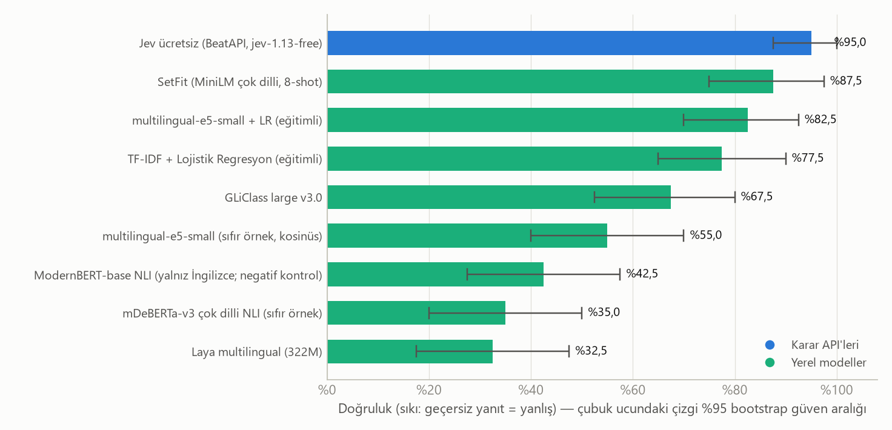
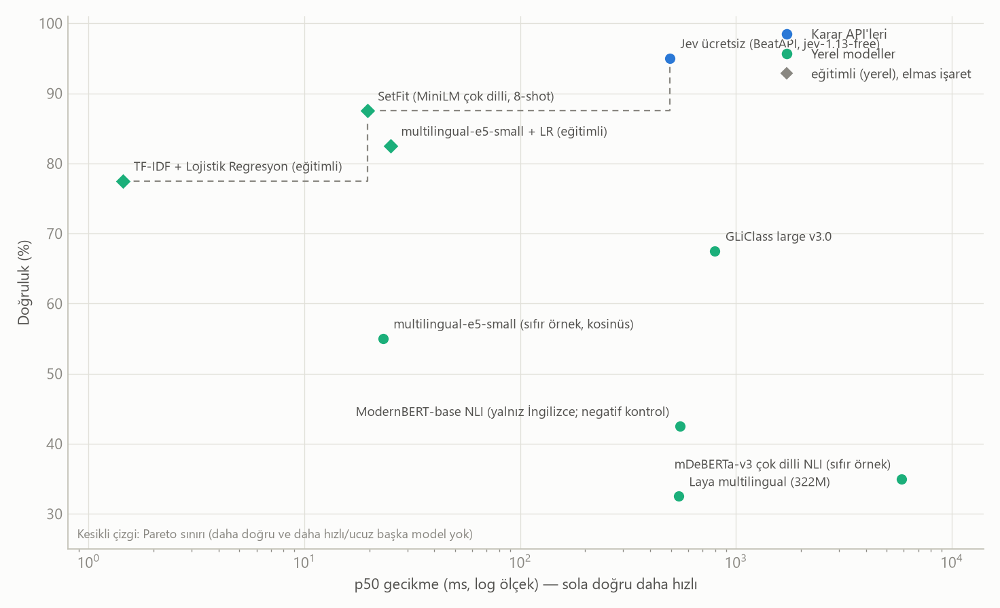
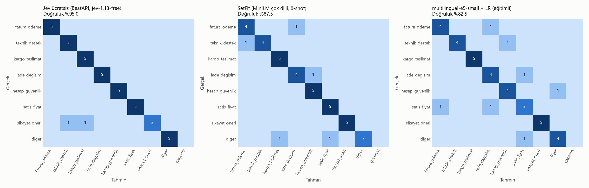

# Classifier LLM karşılaştırma raporu

Koşu: `20261011-005911-jev-40` · oluşturma: 2026-10-11T01:34:52

## Koşul özeti

**Veri:** `destek_tr` · değerlendirme bölümü: `test` (40 örnek) · eğitim bölümü: 128 örnek · parmak izi `9ac13de53ff85f2d`

**Sınıf dağılımı (değerlendirme):** fatura_odeme: 5, teknik_destek: 5, kargo_teslimat: 5, iade_degisim: 5, hesap_guvenlik: 5, satis_fiyat: 5, sikayet_oneri: 5, diger: 5

**Ayarlar:** tohum 0 · etiket başına few-shot 0 · istem sürümü `v1` · seçenek sırası testi: hayır

**Ortam:** Python 3.13.14 · Windows-10-10.0.19045-SP0

**Not:** Jev ücretsiz katmanı dakikada 1 istek sınırlı: tüm modeller aynı dengeli 40 örnekte (sınıf başına 5) çalıştırıldı

## Öne çıkan bulgular

**En yüksek doğruluk:** Jev ücretsiz (BeatAPI, jev-1.13-free) — %95,0 (%95 GA %87,5–%100,0), macro-F1 %94,6.

**İstatistiksel olarak ayırt edilemeyenler (Jev ücretsiz (BeatAPI, jev-1.13-free) ile eşlenmiş bootstrap farkının %95 aralığı 0'ı içeriyor):** SetFit (MiniLM çok dilli, 8-shot), multilingual-e5-small + LR (eğitimli). Bu modeller arasında bu örneklemle kesin sıralama yapılamaz.

**En düşük p50 gecikme:** TF-IDF + Lojistik Regresyon (eğitimli) — 1,4 ms (doğruluk %77,5).

**En düşük ölçülen API maliyeti:** Jev ücretsiz (BeatAPI, jev-1.13-free) — $0,0000 / 1.000 karar (doğruluk %95,0).

**Doğruluk–gecikme Pareto sınırı:** Jev ücretsiz (BeatAPI, jev-1.13-free), SetFit (MiniLM çok dilli, 8-shot), TF-IDF + Lojistik Regresyon (eğitimli).

**Doğruluk–maliyet Pareto sınırı (yalnız fiyatı bilinen API modelleri):** Jev ücretsiz (BeatAPI, jev-1.13-free).

## Ana sonuç tablosu

Doğruluk sıkıdır: geçersiz veya başarısız yanıtlar yanlış sayılır, oranı ayrıca verilir. Köşeli parantez: %95 bootstrap güven aralığı. ECE: kalibrasyon hatası (yüzde puan; düşük iyi). Gecikme: istemci tarafı uçtan uca ms. Maliyet: ölçülen token × tarife, 1.000 karar için USD; `~` token sayısının API'den gelmeyip tahmin edildiğini, `yerel` API ücreti olmadığını gösterir (altyapı maliyeti hariç).

| # | Model | Grup | Doğruluk [%95 GA] | Macro-F1 | Geçersiz | ECE | p50 ms | p95 ms | $/1.000 karar |
|---:|:---|:---|---:|---:|---:|---:|---:|---:|---:|
| 1 | Jev ücretsiz (BeatAPI, jev-1.13-free) | Karar API | %95,0 [%88–%100] | %94,6 | %0,0 | 3,8 pp | 494 | 756 | 0,0000 |
| 2 | SetFit (MiniLM çok dilli, 8-shot) | Eğitimli | %87,5 [%75–%98] | %87,1 | %0,0 | 21,7 pp | 19,6 | 25,3 | yerel |
| 3 | multilingual-e5-small + LR (eğitimli) | Eğitimli | %82,5 [%70–%92] | %82,7 | %0,0 | 32,4 pp | 25,1 | 32,8 | yerel |
| 4 | TF-IDF + Lojistik Regresyon (eğitimli) | Eğitimli | %77,5 [%65–%90] | %77,2 | %0,0 | 31,5 pp | 1,4 | 3,4 | yerel |
| 5 | GLiClass large v3.0 | Encoder | %67,5 [%52–%80] | %65,4 | %0,0 | 32,5 pp | 800 | 924 | yerel |
| 6 | multilingual-e5-small (sıfır örnek, kosinüs) | Encoder | %55,0 [%40–%70] | %49,2 | %0,0 | 33,1 pp | 23,1 | 31,1 | yerel |
| 7 | ModernBERT-base NLI (yalnız İngilizce; negatif kontrol) | Encoder | %42,5 [%28–%57] | %35,8 | %0,0 | 19,9 pp | 552 | 695 | yerel |
| 8 | mDeBERTa-v3 çok dilli NLI (sıfır örnek) | Encoder | %35,0 [%20–%50] | %33,8 | %0,0 | 20,6 pp | 5.860 | 6.744 | yerel |
| 9 | Laya multilingual (322M) | Encoder | %32,5 [%18–%48] | %27,8 | %0,0 | 54,9 pp | 542 | 653 | yerel |

## Kalibrasyon, hız ve kullanım ayrıntıları

Brier: çok sınıflı olasılık hatası (düşük iyi). **Güven türü** karşılaştırmayı sınırlar: üretken LLM'lerde 'sözel güven' modelin yazdığı sayıdır, yerel olasılık değildir; kalibrasyon sayıları bu yüzden doğrudan kıyaslanmamalıdır. Seçici doğruluk: modelin en emin olduğu %80 örnekteki doğruluk ve doğruluğu ≥%95 tutan en büyük kapsama. İlk istek (soğuk) gecikmesi ve kurulum/yükleme/eğitim süresi ayrı verilir; p50/p95 ısınmadan sonraki isteklerdir.

| Model | Brier | Güven türü | Doğruluk@%80 kapsama | Kapsama@%95 doğruluk | p99 ms | Soğuk ms | Kurulum | Eşzamanlılık | Ort. token (g/ç) |
|:---|---:|:---|---:|---:|---:|---:|---:|---:|---:|
| Jev ücretsiz (BeatAPI, jev-1.13-free) | 0,068 | yerel olasılık | %100,0 | %100 | 2.617 | 1.201 | 0,0 sn | 1 | 762 / 103 |
| SetFit (MiniLM çok dilli, 8-shot) | 0,285 | yerel olasılık | %87,5 | %65 | 27,0 | 24,0 | 225,1 sn | 1 | — |
| multilingual-e5-small + LR (eğitimli) | 0,381 | yerel olasılık | %90,6 | %68 | 34,0 | — | 18,4 sn | 1 | — |
| TF-IDF + Lojistik Regresyon (eğitimli) | 0,449 | yerel olasılık | %78,1 | %60 | 4,4 | — | 0,4 sn | 1 | — |
| GLiClass large v3.0 | 0,650 | türetilmiş, yerel olasılık | %68,8 | %2 | 1.019 | 1.390 | 397,6 sn | 1 | — |
| multilingual-e5-small (sıfır örnek, kosinüs) | 0,757 | türetilmiş | %62,5 | %15 | 31,9 | — | 9,3 sn | 1 | — |
| ModernBERT-base NLI (yalnız İngilizce; negatif kontrol) | 0,750 | yerel olasılık | %50,0 | %5 | 722 | — | 116,7 sn | 1 | — |
| mDeBERTa-v3 çok dilli NLI (sıfır örnek) | 0,816 | yerel olasılık | %37,5 | %2 | 7.460 | — | 119,6 sn | 1 | — |
| Laya multilingual (322M) | 1,162 | yerel olasılık | %31,2 | %12 | 871 | 136.463 | 0,1 sn | 1 | — |

## Doğruluk ve gecikme

Gecikme ölçümleri farklı donanım, bağlantı ve eşzamanlılık koşullarında alınmıştır (API: bu makineden uçtan uca; yerel: bu makinenin CPU/GPU'su). Kontrollü bir donanım yarışı değildir.

## Eşlenmiş karşılaştırma (referans: Jev ücretsiz (BeatAPI, jev-1.13-free))

Aynı örnekler üzerinde doğruluk farkı (model − referans) ve %95 eşlenmiş bootstrap aralığı. Aralık 0'ı içeriyorsa bu örneklemle fark kanıtlanamaz.

| Model | Fark (puan) | %95 aralık | Sonuç |
|:---|---:|---:|:---|
| SetFit (MiniLM çok dilli, 8-shot) | -7,5 puan | -20,0 puan … +5,0 puan | ayırt edilemez |
| multilingual-e5-small + LR (eğitimli) | -12,5 puan | -27,5 puan … +2,5 puan | ayırt edilemez |
| TF-IDF + Lojistik Regresyon (eğitimli) | -17,5 puan | -32,5 puan … -2,5 puan | daha kötü |
| GLiClass large v3.0 | -27,5 puan | -42,5 puan … -12,5 puan | daha kötü |
| multilingual-e5-small (sıfır örnek, kosinüs) | -40,0 puan | -55,0 puan … -25,0 puan | daha kötü |
| ModernBERT-base NLI (yalnız İngilizce; negatif kontrol) | -52,5 puan | -67,5 puan … -37,5 puan | daha kötü |
| mDeBERTa-v3 çok dilli NLI (sıfır örnek) | -60,0 puan | -75,0 puan … -42,5 puan | daha kötü |
| Laya multilingual (322M) | -62,5 puan | -77,5 puan … -47,5 puan | daha kötü |

## Sınıf bazında F1

Satır başına model, sütun başına sınıf. Destek sayısı küçük olduğundan tek sınıftaki farklar gürültülü olabilir.

| Model | fatura_odeme | teknik_destek | kargo_teslimat | iade_degisim | hesap_guvenlik | satis_fiyat | sikayet_oneri | diger |
|:---|---:|---:|---:|---:|---:|---:|---:|---:|
| Jev ücretsiz (BeatAPI, jev-1.13-free) | %100 | %91 | %91 | %100 | %100 | %100 | %75 | %100 |
| SetFit (MiniLM çok dilli, 8-shot) | %80 | %89 | %91 | %80 | %91 | %91 | %100 | %75 |
| multilingual-e5-small + LR (eğitimli) | %80 | %89 | %100 | %73 | %80 | %60 | %100 | %80 |
| TF-IDF + Lojistik Regresyon (eğitimli) | %67 | %75 | %77 | %89 | %83 | %75 | %77 | %75 |
| GLiClass large v3.0 | %73 | %62 | %80 | %80 | %57 | %77 | %29 | %67 |
| multilingual-e5-small (sıfır örnek, kosinüs) | %75 | %59 | %80 | %67 | %33 | %55 | %0 | %25 |
| ModernBERT-base NLI (yalnız İngilizce; negatif kontrol) | %25 | %0 | %80 | %50 | %44 | %53 | %33 | %0 |
| mDeBERTa-v3 çok dilli NLI (sıfır örnek) | %0 | %0 | %80 | %33 | %73 | %55 | %12 | %18 |
| Laya multilingual (322M) | %29 | %27 | %50 | %73 | %0 | %44 | %0 | %0 |

## Karışıklık matrisleri (en doğru 3 model)

Satırlar gerçek, sütunlar tahmin edilen sınıf; renk satır normalizasyonudur, hücrelerdeki sayılar örnek sayısıdır.

## Atlanan veya hatalı modeller

Bu modeller ya hiç puanlanamadı ya da bazı istekleri başarısız oldu. Başarısız istekler doğrulukta yanlış sayılır.

| Model | Durum | Neden / ilk hata |
|:---|:---|:---|
| Jev (jev-ai.pro) | atlandı | ProviderError: Erişim/ödeme hatası (HTTP 402: {   "error": true,   "url": "https://jev-ai.pro/api/v1/systemone",   "statusCode": 402,   "statusMessage": "Credit and token balances are insufficient.",   "message": "Credit and token balan). Anahtarı, bakiyeyi, m |
| Instinct 27B (ZooData) | atlandı | ProviderError: Erişim/ödeme hatası (HTTP 402: {"success":false,"error":{"code":"PAYMENT_REQUIRED","message":"wallet_not_provisioned"},"meta":{"requestId":"req_7d47d9c0e5444cd8","timestamp":"2026-10-10T22:34:50.059844Z"}}). Anahtarı, bakiyeyi, model adını ve ba |
| Instinct tuned 4B (ZooData) | atlandı | ProviderError: Erişim/ödeme hatası (HTTP 402: {"success":false,"error":{"code":"PAYMENT_REQUIRED","message":"wallet_not_provisioned"},"meta":{"requestId":"req_07c49f8698594ce9","timestamp":"2026-10-10T22:34:50.263237Z"}}). Anahtarı, bakiyeyi, model adını ve ba |
| Instinct dual 4B (ZooData) | atlandı | ProviderError: Erişim/ödeme hatası (HTTP 402: {"success":false,"error":{"code":"PAYMENT_REQUIRED","message":"wallet_not_provisioned"},"meta":{"requestId":"req_d79bebcc49514b42","timestamp":"2026-10-10T22:34:50.442198Z"}}). Anahtarı, bakiyeyi, model adını ve ba |
| Mercury 2.5 (sohbet, OpenRouter) | atlandı | ProviderError: Erişim/ödeme hatası (HTTP 402: {"error":{"message":"Insufficient credits. This account never purchased credits. Make sure your key is on the correct account or org, and if so, purchase more at https://openrouter.ai/settin). Anahtarı, bakiyeyi, m |
| GPT-6 Luna (sohbet, OpenRouter) | atlandı | ProviderError: Erişim/ödeme hatası (HTTP 402: {"error":{"message":"Insufficient credits. This account never purchased credits. Make sure your key is on the correct account or org, and if so, purchase more at https://openrouter.ai/settin). Anahtarı, bakiyeyi, m |
| DeepSeek V4 Flash (OpenRouter) | atlandı | ProviderError: Erişim/ödeme hatası (HTTP 402: {"error":{"message":"Insufficient credits. This account never purchased credits. Make sure your key is on the correct account or org, and if so, purchase more at https://openrouter.ai/settin). Anahtarı, bakiyeyi, m |
| Qwen3.8 Flash (OpenRouter) | atlandı | ProviderError: Erişim/ödeme hatası (HTTP 402: {"error":{"message":"Insufficient credits. This account never purchased credits. Make sure your key is on the correct account or org, and if so, purchase more at https://openrouter.ai/settin). Anahtarı, bakiyeyi, m |

## Bu koşuda çalıştırılmayan modeller

Kayıt defterinde olup bu koşuya **girmeyen** 14 model var (puanlanan: 9). Bunlar denenip başarısız olmadı; anahtarı/paketi eksik olduğu ya da varsayılan kapalı olduğu için hiç çağrılmadı, dolayısıyla sonuçları bu raporda yoktur. Bunların 5 tanesi ücretsiz (veya ücretsiz olabilir) kullanılabilir; `python -m clfbench run --free` yalnız doğrulanmış ücretsiz olanları seçer.

| Model | Ücret durumu | Neden çalışmadı | Nasıl açılır |
|:---|:---|:---|:---|
| Jev 1.13 (TypeSafe) | ücretli | TYPESAFE_API_KEY tanımlı değil (bu koşuda) | `.env` içine `TYPESAFE_API_KEY=...` ekle · anahtar: https://docs.typesafe.ai |
| Mercury Decide (Inception) | Ücretsiz olabilir (doğrulanmadı) | INCEPTION_API_KEY tanımlı değil (bu koşuda) | `.env` içine `INCEPTION_API_KEY=...` ekle · anahtar: https://platform.inceptionlabs.ai/dashboard/api-keys |
| Liquid d1 API | Ücretsiz olabilir (doğrulanmadı) | LIQUID_API_KEY tanımlı değil (bu koşuda) | `.env` içine `LIQUID_API_KEY=...` ekle · anahtar: https://console.liquid.ai |
| OpenAI Decisions (gpt-6-luna) | ücretli | OPENAI_API_KEY tanımlı değil (bu koşuda) | `.env` içine `OPENAI_API_KEY=...` ekle · anahtar: https://platform.openai.com/api-keys |
| Claude Haiku 5.5 | ücretli | ANTHROPIC_API_KEY tanımlı değil (bu koşuda) | `.env` içine `ANTHROPIC_API_KEY=...` ekle · anahtar: https://platform.claude.com/settings/keys |
| Claude Sonnet 5.5 | ücretli | ANTHROPIC_API_KEY tanımlı değil (bu koşuda) | `.env` içine `ANTHROPIC_API_KEY=...` ekle · anahtar: https://platform.claude.com/settings/keys |
| Gemini 3.5 Flash-Lite | Ücretsiz olabilir (doğrulanmadı) | GEMINI_API_KEY tanımlı değil (bu koşuda) | `.env` içine `GEMINI_API_KEY=...` ekle · anahtar: https://aistudio.google.com/apikey |
| Mercury 2.5 (sohbet, Inception) | Ücretsiz olabilir (doğrulanmadı) | INCEPTION_API_KEY tanımlı değil (bu koşuda) | `.env` içine `INCEPTION_API_KEY=...` ekle · anahtar: https://platform.inceptionlabs.ai/dashboard/api-keys |
| Sage 1.3 (Levanto) | ücretli | varsayılan kapalı (configs/models.yaml: enabled: false) | `--models sage` ile açıkça iste (şablon: uç nokta doğrulanmadı) |
| Microsoft-Decision-1 (Foundry) | ücretli | varsayılan kapalı (configs/models.yaml: enabled: false) | `--models microsoft_decision_1` ile açıkça iste (şablon: uç nokta doğrulanmadı) |
| Claude Opus 5.5 | ücretli | varsayılan kapalı (configs/models.yaml: enabled: false) | `--models claude_opus_5_5` ile açıkça iste |
| Gemini 3.8 Flash | ücretli | varsayılan kapalı (configs/models.yaml: enabled: false) | `--models gemini_3_8_flash` ile açıkça iste |
| Qwen3.8 27B (OpenRouter) | ücretli | varsayılan kapalı (configs/models.yaml: enabled: false) | `--models qwen3_8_27b` ile açıkça iste |
| Gemma 4 31B (OpenRouter ücretsiz) | Ücretsiz olabilir (doğrulanmadı) | varsayılan kapalı (configs/models.yaml: enabled: false) | `--models gemma_4_31b_free` ile açıkça iste |

## Yöntem ve sınırlar

- **Veri:** Yerleşik `destek_tr` seti, bu çalışma için hazırlanmış *gümüş* etiketli bir örnek kümesidir; insan etiketli altın küme DEĞİLDİR. Bir satın alma kararı için kendi, insan etiketli Türkçe verinizle (`--dataset`) yeniden çalıştırın.

- **Bölme:** Değerlendirme yalnızca `test` (veya istenen) bölümünde yapılır; eğitimli modeller yalnızca `train` bölümünü görür; few-shot örnekleri de `train`'den alınır ve değerlendirmeden çıkarılır.

- **Aynı görev, doğal arayüz:** Karar API'leri kendi `choice` şemasıyla, üretken LLM'ler aynı Türkçe talimat + JSON şemasıyla, encoder modeller etiketlerin kısa Türkçe adlarıyla çağrılır. Bu, her modelin doğal arayüzünü adil kullanır ama modeller arasındaki farkın bir kısmı istem/arayüz farkından gelebilir.

- **Güven/olasılık:** Karar API'leri ve yerel modeller yerel olasılık verir; üretken LLM'ler sözel güven yazar. Brier/ECE bu yüzden aynı ölçekte değildir.

- **Gecikme:** İstemci tarafı uçtan uca süre. Konum, ağ, eşzamanlılık ve sunucu yükü sonucu etkiler; ısınma isteği hariç tutulur. Yerel gecikmeler bu makinenin donanımına aittir.

- **Maliyet:** Yanıttan okunan token kullanımı × tarife. API token vermiyorsa tahmin edilir ve `~` ile işaretlenir. Abonelik, minimum bakiye, yeniden deneme ve altyapı hariçtir.

- **İstatistik:** Güven aralıkları örnekler üzerinde bootstrap (2000) ile hesaplanır; küçük farklardan kazanan çıkarılamaz.

- **Tarifeler (USD / 1M giriş / çıkış):** Jev ücretsiz (BeatAPI, jev-1.13-free): 0,000 / 0,000 (Ücretsiz katman (sıfır bakiyede çalıştığı iddia ediliyor); limitler doğrulanmadı); Instinct 27B (ZooData): 0,030 / 0,000 (En az 20 USD bakiye yüklemesi gerekir); Instinct tuned 4B (ZooData): 0,010 / 0,000 (En az 20 USD bakiye yüklemesi gerekir); Instinct dual 4B (ZooData): 0,010 / 0,000 (En az 20 USD bakiye yüklemesi gerekir); Mercury 2.5 (sohbet, OpenRouter): 0,040 / 0,150; GPT-6 Luna (sohbet, OpenRouter): 0,100 / 0,500; DeepSeek V4 Flash (OpenRouter): 0,030 / 1,280 (Sağlayıcıya göre değişebilir; reasoning çıktı tokenı yükseltir); Qwen3.8 Flash (OpenRouter): 0,150 / 0,470

- **Sürüm:** clfbench 0.1.0 · git 7e4cf16 · paketler: requests 2.34.2, numpy 2.5.4, anthropic 1.13.0, scikit-learn 1.9.1, torch 2.14.1, transformers 5.19.0, sentence-transformers 6.1.0, gliclass 0.1.20, laya 0.4.2, setfit 1.2.0
