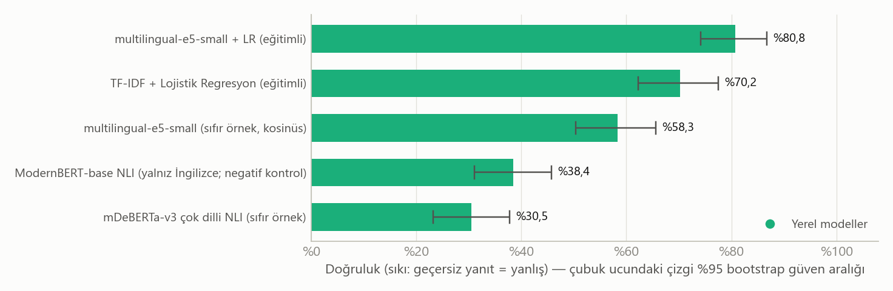
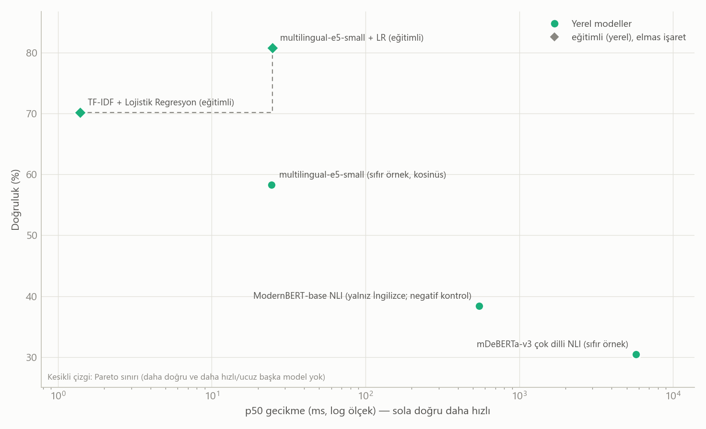
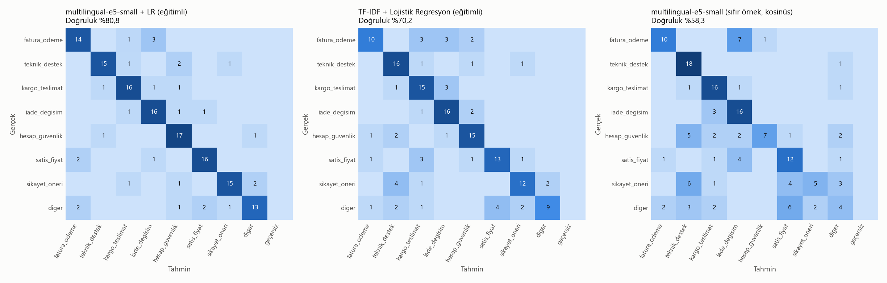

# Classifier LLM karşılaştırma raporu

Koşu: `20261010-220750-yerel-taban` · oluşturma: 2026-10-10T22:26:23

## Koşul özeti

**Veri:** `destek_tr` · değerlendirme bölümü: `test` (151 örnek) · eğitim bölümü: 128 örnek · parmak izi `9ac13de53ff85f2d`

**Sınıf dağılımı (değerlendirme):** fatura_odeme: 18, teknik_destek: 19, kargo_teslimat: 19, iade_degisim: 19, hesap_guvenlik: 19, satis_fiyat: 19, sikayet_oneri: 19, diger: 19

**Ayarlar:** tohum 0 · etiket başına few-shot 0 · istem sürümü `v1` · seçenek sırası testi: evet

**Ortam:** Python 3.13.14 · Windows-10-10.0.19045-SP0

**Not:** Yalnız yerel modeller, 4 iş parçacıklı dizüstü CPU (Windows 10); gecikmeler bu donanıma aittir

## Öne çıkan bulgular

**En yüksek doğruluk:** multilingual-e5-small + LR (eğitimli) — %80,8 (%95 GA %74,2–%86,8), macro-F1 %80,7.

multilingual-e5-small + LR (eğitimli) ile eşlenmiş farkı sıfırı içeren başka model yok.

**En düşük p50 gecikme:** TF-IDF + Lojistik Regresyon (eğitimli) — 1,4 ms (doğruluk %70,2).

**Doğruluk–gecikme Pareto sınırı:** multilingual-e5-small + LR (eğitimli), TF-IDF + Lojistik Regresyon (eğitimli).

## Ana sonuç tablosu

Doğruluk sıkıdır: geçersiz veya başarısız yanıtlar yanlış sayılır, oranı ayrıca verilir. Köşeli parantez: %95 bootstrap güven aralığı. ECE: kalibrasyon hatası (yüzde puan; düşük iyi). Gecikme: istemci tarafı uçtan uca ms. Maliyet: ölçülen token × tarife, 1.000 karar için USD; `~` token sayısının API'den gelmeyip tahmin edildiğini, `yerel` API ücreti olmadığını gösterir (altyapı maliyeti hariç).

| # | Model | Grup | Doğruluk [%95 GA] | Macro-F1 | Geçersiz | ECE | p50 ms | p95 ms | $/1.000 karar |
|---:|:---|:---|---:|---:|---:|---:|---:|---:|---:|
| 1 | multilingual-e5-small + LR (eğitimli) | Eğitimli | %80,8 [%74–%87] | %80,7 | %0,0 | 34,0 pp | 24,9 | 31,1 | yerel |
| 2 | TF-IDF + Lojistik Regresyon (eğitimli) | Eğitimli | %70,2 [%62–%77] | %69,7 | %0,0 | 25,8 pp | 1,4 | 2,5 | yerel |
| 3 | multilingual-e5-small (sıfır örnek, kosinüs) | Encoder | %58,3 [%50–%66] | %55,6 | %0,0 | 37,3 pp | 24,6 | 29,5 | yerel |
| 4 | ModernBERT-base NLI (yalnız İngilizce; negatif kontrol) | Encoder | %38,4 [%31–%46] | %36,7 | %0,0 | 11,3 pp | 549 | 688 | yerel |
| 5 | mDeBERTa-v3 çok dilli NLI (sıfır örnek) | Encoder | %30,5 [%23–%38] | %32,1 | %0,0 | 17,4 pp | 5.755 | 6.818 | yerel |

## Kalibrasyon, hız ve kullanım ayrıntıları

Brier: çok sınıflı olasılık hatası (düşük iyi). **Güven türü** karşılaştırmayı sınırlar: üretken LLM'lerde 'sözel güven' modelin yazdığı sayıdır, yerel olasılık değildir; kalibrasyon sayıları bu yüzden doğrudan kıyaslanmamalıdır. Seçici doğruluk: modelin en emin olduğu %80 örnekteki doğruluk ve doğruluğu ≥%95 tutan en büyük kapsama. İlk istek (soğuk) gecikmesi ve kurulum/yükleme/eğitim süresi ayrı verilir; p50/p95 ısınmadan sonraki isteklerdir.

| Model | Brier | Güven türü | Doğruluk@%80 kapsama | Kapsama@%95 doğruluk | p99 ms | Soğuk ms | Kurulum | Eşzamanlılık | Ort. token (g/ç) |
|:---|---:|:---|---:|---:|---:|---:|---:|---:|---:|
| multilingual-e5-small + LR (eğitimli) | 0,429 | yerel olasılık | %86,0 | %28 | 34,0 | — | 13,0 sn | 1 | — |
| TF-IDF + Lojistik Regresyon (eğitimli) | 0,504 | yerel olasılık | %76,9 | %25 | 3,6 | — | 1,8 sn | 1 | — |
| multilingual-e5-small (sıfır örnek, kosinüs) | 0,760 | türetilmiş | %66,1 | %14 | 33,7 | — | 4,4 sn | 1 | — |
| ModernBERT-base NLI (yalnız İngilizce; negatif kontrol) | 0,737 | yerel olasılık | %45,5 | %1 | 721 | — | 146,2 sn | 1 | — |
| mDeBERTa-v3 çok dilli NLI (sıfır örnek) | 0,850 | yerel olasılık | %33,1 | %3 | 7.629 | — | 1,9 sn | 1 | — |

## Doğruluk ve gecikme

Gecikme ölçümleri farklı donanım, bağlantı ve eşzamanlılık koşullarında alınmıştır (API: bu makineden uçtan uca; yerel: bu makinenin CPU/GPU'su). Kontrollü bir donanım yarışı değildir.

## Eşlenmiş karşılaştırma (referans: multilingual-e5-small + LR (eğitimli))

Aynı örnekler üzerinde doğruluk farkı (model − referans) ve %95 eşlenmiş bootstrap aralığı. Aralık 0'ı içeriyorsa bu örneklemle fark kanıtlanamaz.

| Model | Fark (puan) | %95 aralık | Sonuç |
|:---|---:|---:|:---|
| TF-IDF + Lojistik Regresyon (eğitimli) | -10,6 puan | -18,5 puan … -3,3 puan | daha kötü |
| multilingual-e5-small (sıfır örnek, kosinüs) | -22,5 puan | -31,1 puan … -13,9 puan | daha kötü |
| ModernBERT-base NLI (yalnız İngilizce; negatif kontrol) | -42,4 puan | -51,7 puan … -33,1 puan | daha kötü |
| mDeBERTa-v3 çok dilli NLI (sıfır örnek) | -50,3 puan | -60,3 puan … -40,4 puan | daha kötü |

## Sınıf bazında F1

Satır başına model, sütun başına sınıf. Destek sayısı küçük olduğundan tek sınıftaki farklar gürültülü olabilir.

| Model | fatura_odeme | teknik_destek | kargo_teslimat | iade_degisim | hesap_guvenlik | satis_fiyat | sikayet_oneri | diger |
|:---|---:|---:|---:|---:|---:|---:|---:|---:|
| multilingual-e5-small + LR (eğitimli) | %78 | %83 | %82 | %80 | %81 | %84 | %83 | %74 |
| TF-IDF + Lojistik Regresyon (eğitimli) | %65 | %73 | %68 | %76 | %75 | %72 | %69 | %60 |
| multilingual-e5-small (sıfır örnek, kosinüs) | %65 | %69 | %73 | %65 | %52 | %57 | %38 | %26 |
| ModernBERT-base NLI (yalnız İngilizce; negatif kontrol) | %47 | %19 | %59 | %43 | %38 | %36 | %43 | %9 |
| mDeBERTa-v3 çok dilli NLI (sıfır örnek) | %36 | %10 | %69 | %23 | %58 | %30 | %21 | %11 |

## Karışıklık matrisleri (en doğru 3 model)

Satırlar gerçek, sütunlar tahmin edilen sınıf; renk satır normalizasyonudur, hücrelerdeki sayılar örnek sayısıdır.

## Zor örnek dilimleri

Doğruluk, örnek etiketine göre. En az 5 örnek içeren dilimler gösterilir; n küçük olduğundan yalnızca yön göstericidir.

| Model | Türkçe karaktersiz (ascii) | Çok niyetli | Çok kısa (≤4 sözcük) |
|:---|---:|---:|---:|
| multilingual-e5-small + LR (eğitimli) | %80 (n=5) | %40 (n=5) | %75 (n=12) |
| TF-IDF + Lojistik Regresyon (eğitimli) | %80 (n=5) | %40 (n=5) | %50 (n=12) |
| multilingual-e5-small (sıfır örnek, kosinüs) | %80 (n=5) | %60 (n=5) | %50 (n=12) |
| ModernBERT-base NLI (yalnız İngilizce; negatif kontrol) | %60 (n=5) | %0 (n=5) | %25 (n=12) |
| mDeBERTa-v3 çok dilli NLI (sıfır örnek) | %80 (n=5) | %40 (n=5) | %25 (n=12) |

## Yöntem ve sınırlar

- **Veri:** Yerleşik `destek_tr` seti, bu çalışma için hazırlanmış *gümüş* etiketli bir örnek kümesidir; insan etiketli altın küme DEĞİLDİR. Bir satın alma kararı için kendi, insan etiketli Türkçe verinizle (`--dataset`) yeniden çalıştırın.

- **Bölme:** Değerlendirme yalnızca `test` (veya istenen) bölümünde yapılır; eğitimli modeller yalnızca `train` bölümünü görür; few-shot örnekleri de `train`'den alınır ve değerlendirmeden çıkarılır.

- **Aynı görev, doğal arayüz:** Karar API'leri kendi `choice` şemasıyla, üretken LLM'ler aynı Türkçe talimat + JSON şemasıyla, encoder modeller etiketlerin kısa Türkçe adlarıyla çağrılır. Bu, her modelin doğal arayüzünü adil kullanır ama modeller arasındaki farkın bir kısmı istem/arayüz farkından gelebilir.

- **Güven/olasılık:** Karar API'leri ve yerel modeller yerel olasılık verir; üretken LLM'ler sözel güven yazar. Brier/ECE bu yüzden aynı ölçekte değildir.

- **Gecikme:** İstemci tarafı uçtan uca süre. Konum, ağ, eşzamanlılık ve sunucu yükü sonucu etkiler; ısınma isteği hariç tutulur. Yerel gecikmeler bu makinenin donanımına aittir.

- **Maliyet:** Yanıttan okunan token kullanımı × tarife. API token vermiyorsa tahmin edilir ve `~` ile işaretlenir. Abonelik, minimum bakiye, yeniden deneme ve altyapı hariçtir.

- **İstatistik:** Güven aralıkları örnekler üzerinde bootstrap (2000) ile hesaplanır; küçük farklardan kazanan çıkarılamaz.

- **Tarifeler (USD / 1M giriş / çıkış):** —

- **Sürüm:** clfbench 0.1.0 · git 122cd27 · paketler: requests 2.32.5, numpy 2.3.5, anthropic 0.55.0, scikit-learn 1.7.2, torch 2.9.1, transformers 4.57.3, sentence-transformers 5.1.2
